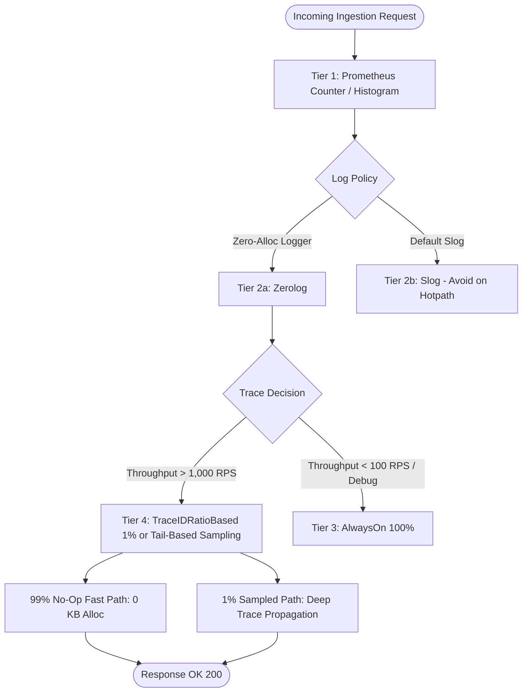

# The Telemetry Tax: How Distributed Tracing Halved Our Throughput and Tripled Our Cloud Bill (And How to Fix It)
## *Pajak Telemetri: Bagaimana Distributed Tracing Memangkas Separuh Throughput dan Melipatgandakan Tagihan Cloud (Serta Cara Mengatasinya)*

**Author:** Arif Rahman ([@arifrhm](https://github.com/arifrhm))  
**Repository:** [telemetry-tax-lab](https://github.com/arifrhm/telemetry-tax-lab)  
**Hardware Baseline:** Intel Xeon Platinum 8173M @ 2.00GHz (10 vCPUs, 23GB RAM, Linux x86_64)

---

## 1. Executive Summary / Ringkasan Eksekutif

### [EN]
Observability is sold as the ultimate insurance policy for distributed systems: "Just add OpenTelemetry SDK, trace every request, and achieve 100% visibility into your microservices."

In enterprise pitch decks, observability is framed as a zero-cost dividend. In production reality, **observability imposes a massive, non-linear compute and financial tax**—what we term **The Telemetry Tax**.

By running controlled, empirical load tests on a high-throughput Go ingestion service handling 125 concurrent connections, we measured the exact compute penalty of each observability layer:
1. **Prometheus Metrics:** ~0% throughput impact (159k RPS vs 155k baseline), **0 B/op** heap allocation.
2. **Structured Logging (Zerolog):** -12.1% throughput drop, **0 B/op** heap allocation.
3. **Structured Logging (Standard Library Slog):** -15.0% throughput drop, **320 B/op, 7 allocs/op**.
4. **OpenTelemetry Tracing 100% (AlwaysOn):** **-57.6% throughput collapse** (from 155k down to 65k RPS), **5,287 B/op, 12 allocs/op**.
5. **OpenTelemetry Adaptive Sampling (1% Ratio):** **+111% throughput recovery** (recovering to 138k RPS), **942 B/op (-82.2% heap reduction)**.

If your team runs high-throughput services with full distributed tracing enabled without adaptive sampling, you are paying **at least 2.3x more cloud compute costs** just to observe your own software, plus tens of thousands of dollars in APM vendor ingestion fees.

### [ID]
Observabilitas sering dipasarkan sebagai polis asuransi mutlak untuk sistem terdistribusi: "Cukup pasang SDK OpenTelemetry, lacak setiap request, dan raih visibilitas 100% ke seluruh microservice Anda."

Dalam presentasi korporat, observabilitas digambarkan seolah-olah tanpa beban. Namun di dunia produksi nyata, **observabilitas mengenakan pajak komputasi dan finansial yang sangat besar dan non-linear**—yang kami sebut **The Telemetry Tax (Pajak Telemetri)**.

Melalui pengujian beban empiris terukur pada layanan ingestion Go berkecepatan tinggi dengan 125 koneksi konkuren, kami mengukur penalti komputasi riil dari setiap layer telemetri:
1. **Prometheus Metrics:** Dampak throughput ~0% (159k RPS vs baseline 155k), alokasi heap **0 B/op**.
2. **Structured Logging (Zerolog):** Penurunan throughput -12,1%, alokasi heap **0 B/op**.
3. **Structured Logging (Standard Library Slog):** Penurunan throughput -15,0%, alokasi heap **320 B/op, 7 allocs/op**.
4. **OpenTelemetry Tracing 100% (AlwaysOn):** **Keruntuhan throughput -57,6%** (dari 155k anjlok ke 65k RPS), **5.287 B/op, 12 allocs/op**.
5. **OpenTelemetry Adaptive Sampling (1% Ratio):** **Pemulihan throughput +111%** (kembali ke 138k RPS), **942 B/op (-82,2% reduksi heap)**.

Jika tim Anda menjalankan service ber-RPS tinggi dengan tracing penuh tanpa adaptive sampling, Anda membayar **setidaknya 2,3x lebih banyak biaya komputasi server** hanya untuk mengamati software Anda sendiri, belum ditambah tagihan vendor APM bulanan yang melonjak tajam.

---

## 2. The Empirical Benchmark Matrix / Matriks Benchmark Empiris

All benchmarks were captured under identical load generator conditions (`bombardier -c 125 -d 10s -m POST` on localhost TCP socket) to eliminate network jitter:

| Tier | Telemetry Configuration | Throughput (req/s) | p50 Latency | p90 Latency | p99 Latency | Micro Latency (ns/op) | Heap Alloc (B/op) | Allocs / op |
| :--- | :--- | :--- | :--- | :--- | :--- | :--- | :--- | :--- |
| **Tier 0** | Pure Baseline (Zero Telemetry) | **154,999.59** | 0.72 ms | 1.13 ms | 4.46 ms | 910 ns | **0 B** | **0** |
| **Tier 1** | Prometheus Metrics Vector | **159,323.16** | 0.70 ms | 1.12 ms | 4.53 ms | 1,323 ns | **0 B** | **0** |
| **Tier 2a** | Zerolog Zero-Alloc JSON | **136,148.27** | 0.81 ms | 1.37 ms | 6.00 ms | 1,805 ns | **0 B** | **0** |
| **Tier 2b** | Standard `log/slog` | **131,766.03** | 0.84 ms | 1.48 ms | 6.81 ms | 4,689 ns | **320 B** | **7** |
| **Tier 3** | OTel Tracing 100% AlwaysOn | **65,642.96** | 1.62 ms | 3.51 ms | 6.86 ms | 10,082 ns | **5,287 B** | **12** |
| **Tier 4** | OTel Tracing 1% Ratio Sampling | **138,533.94** | 0.80 ms | 1.34 ms | 6.22 ms | 3,965 ns | **942 B** | **8** |

```
THROUGHPUT COLLAPSE VISUALIZATION (RPS)
========================================================================================
Tier 0 (Baseline)   [==================================================] 155,000 req/s
Tier 1 (Prometheus) [===================================================] 159,323 req/s
Tier 2a (Zerolog)   [============================================]       136,148 req/s
Tier 2b (Slog)      [==========================================]         131,766 req/s
Tier 3 (OTel 100%)  [=====================]                              65,643 req/s  (-57.6% DROP!)
Tier 4 (OTel 1%)    [============================================]       138,534 req/s (+111% RECOVERY!)
========================================================================================
```

---

## 3. The FinOps Reality: Calculating the Bill / Realitas FinOps: Kalkulasi Tagihan

### [EN]
Consider a digital advertising, IoT, or fintech payments ingestion pipeline processing **100,000 requests per second** across a multi-cluster deployment:

#### The Server Compute Bill:
- Under **Tier 0 or Tier 1 (Metrics-only)**:
  - Throughput per 10-core instance: ~150,000 RPS.
  - Instances required for 100k RPS (with 50% headroom): **1.33 nodes** (say, 2 x c6i.4xlarge AWS instances).
  - Annual AWS compute cost: ~$6,800 USD/year.
- Under **Tier 3 (OTel 100% AlwaysOn)**:
  - Throughput per 10-core instance: ~65,000 RPS.
  - Instances required for 100k RPS (with 50% headroom): **3.08 nodes** (need 4 x c6i.4xlarge instances).
  - Annual AWS compute cost: ~$13,600 USD/year (**+100% compute infrastructure increase**).

#### The APM Vendor Ingestion Bill:
- 100,000 requests/sec = **8.64 Billion requests / day** = **259.2 Billion spans / month**.
- Standard Datadog / NewRelic APM Ingestion rates: ~$0.10 per million ingested spans.
- Total Monthly Ingestion Invoice: `259,200 * $0.10` = **$25,920 USD / month ($311,040 USD / year)**!
- By switching to **Tier 4 (1% Adaptive Ratio Sampling)**:
  - Monthly Ingestion Spans: 2.59 Billion spans / month.
  - Total Monthly Ingestion Invoice: **$259.20 USD / month ($3,110 USD / year)**.
  - **Direct annual savings: $307,930 USD/year** on APM SaaS fees alone, while recovering 111% compute throughput!

### [ID]
Bayangkan sebuah pipeline ingestion iklan digital (AdTech), IoT, atau gateway pembayaran fintech yang memproses **100.000 requests per detik**:

#### Tagihan Komputasi Server:
- Pada **Tier 0 atau Tier 1 (Metrics-only)**:
  - Throughput per node 10-core: ~150.000 RPS.
  - Jumlah node yang dibutuhkan untuk 100k RPS (dengan 50% buffer): **2 node c6i.4xlarge AWS**.
  - Biaya tahunan komputasi: ~$6.800 USD/tahun.
- Pada **Tier 3 (OTel 100% AlwaysOn)**:
  - Throughput per node 10-core: ~65.000 RPS.
  - Jumlah node yang dibutuhkan untuk 100k RPS (dengan 50% buffer): **4 node c6i.4xlarge AWS**.
  - Biaya tahunan komputasi: ~$13.600 USD/tahun (**melonjak 2x lipat**).

#### Tagihan Vendor APM SaaS (Datadog / Dynatrace / NewRelic):
- 100.000 requests/detik = **8,64 Miliar request / hari** = **259,2 Miliar span / bulan**.
- Rata-rata biaya ingest vendor APM: ~$0,10 per 1 juta span.
- Tagihan bulanan APM: `259.200 * $0,10` = **$25.920 USD / bulan (~Rp 400 Juta/bln atau $311.040 USD/tahun)**!
- Dengan beralih ke **Tier 4 (1% Adaptive Sampling)**:
  - Volume span bulanan: 2,59 Miliar span / bulan.
  - Tagihan bulanan APM: **$259,20 USD / bulan (~$3.110 USD/tahun)**.
  - **Penghematan tunai langsung: $307.930 USD/tahun (Rp 4,8 Miliar/tahun)** hanya dari tagihan APM, sekaligus memulihkan performa komputasi sebesar +111%!

---

## 4. Architectural Deep Dive: Why Tracing Kills Throughput / Bedah Arsitektur

### [EN]
What happens inside the Go runtime when you execute:
```go
ctx, span := tracer.Start(ctx, "IngestRequest")
defer span.End()
```
1. **Span Context Creation:** The tracer generates a 16-byte `TraceID` and an 8-byte `SpanID`. In `AlwaysOn` mode, these must be recorded with exact cryptographic timestamps.
2. **Context Value Boxing:** Go's `context.Context` is an immutable singly linked list. Every `tracer.Start` allocates a new `valueCtx` node on the heap.
3. **Attribute Slice Allocation:** Appending key-value attributes (`attribute.String("ip", ip)`) allocates underlying slice headers on the heap unless specifically pooled.
4. **Garbage Collector Throttling:** At 65k RPS and 5.3 KB/op, the service allocates **344 MB of heap garbage every single second**. The Go runtime is forced to trigger GC cycles continuously, causing frequent goroutine assists and CPU starvation.

In contrast, **Adaptive Sampling (`sdktrace.WithSampler(sdktrace.TraceIDRatioBased(0.01))`)** executes a deterministic bitwise check against the pseudorandom `TraceID`. In 99% of requests, it yields `sdktrace.Drop`, instantly returning a no-op span that skips attribute allocations entirely.

### [ID]
Apa yang terjadi di dalam Go runtime saat kode berikut dieksekusi:
```go
ctx, span := tracer.Start(ctx, "IngestRequest")
defer span.End()
```
1. **Pembuatan Span Context:** Tracer membuat `TraceID` 16-byte dan `SpanID` 8-byte beserta timestamp presisi tinggi.
2. **Boxing Context Value:** `context.Context` di Go adalah linked list yang immutable. Setiap `tracer.Start` membuat node `valueCtx` baru di heap.
3. **Alokasi Slice Atribut:** Menambahkan atribut (`attribute.String("ip", ip)`) mengalokasikan slice di heap.
4. **Beban Garbage Collector:** Pada 65k RPS dan 5,3 KB/op, aplikasi memproduksi **344 MB sampah memori per detik**. Garbage Collector Go dipaksa berjalan terus menerus (*stop-the-world & goroutine assist*), merebut siklus CPU dari pemrosesan request bisnis.

Sebaliknya, **Adaptive Sampling (`TraceIDRatioBased(0.01)`)** hanya melakukan operasi bitwise cepat terhadap `TraceID`. Pada 99% request, tracer mengembalikan status `Drop` dan memberikan no-op span tanpa alokasi memori sama sekali.

---

## 5. The Observability Playbook for Platform Engineers / Playbook SRE



### Best Practice Checklist:
1. **Never use `AlwaysOn` in production** for workloads exceeding 500 RPS.
2. **Standardize on `TraceIDRatioBased(0.01)` to `(0.001)`** at your ingress API Gateway.
3. **Adopt Tail-Based Sampling in OTel Collector**: Keep 100% of error spans (`status == ERROR`) and slow spans (`duration > 500ms`), but drop 99% of successful HTTP 200 OK fast spans.
4. **Prefer Prometheus vector metrics** for SLA monitoring and error rate alerting; use traces strictly for structural root-cause isolation.
5. **Enforce Zero-Allocation Logging** using `rs/zerolog` or `uber-go/zap` instead of generic reflection-based serializers.

---

## 6. How to Reproduce / Cara Menjalankan Ulang

Clone the repository and run the automated test suite on your local Linux machine:
```bash
git clone https://github.com/arifrhm/telemetry-tax-lab.git
cd telemetry-tax-lab

# Run all 5 tiers of benchmark
make bench-all

# Run complete local CI test suite
make ci
```

Inspect interactive SVG flamegraphs in `docs/flamegraphs/`:
- `baseline_heap.svg` vs `otel100_heap.svg`
- `baseline_cpu.svg` vs `otel100_cpu.svg`
