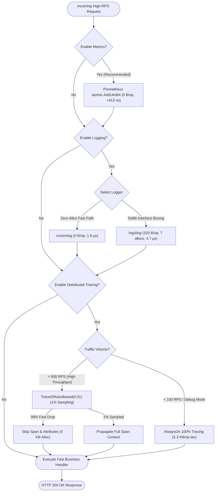

# Visual Evolution & Telemetry Tax Architecture Matrix
## *Matriks Visual Evolusi & Keputusan Pajak Telemetri*

---

## 1. Throughput & Memory Consumption Matrix

```
+------------------------------------+------------------+------------------+------------------+-----------------+
| Configuration Tier                 | Throughput (RPS) | Micro Speed (ns) | Heap Alloc (B)   | Allocs / op     |
+------------------------------------+------------------+------------------+------------------+-----------------+
| Tier 0: Pure Baseline              | 154,999.59 RPS   | 910 ns/op        | 0 B/op           | 0 allocs/op     |
| Tier 1: Prometheus Metrics         | 159,323.16 RPS   | 1,323 ns/op      | 0 B/op           | 0 allocs/op     |
| Tier 2a: Zerolog Zero-Alloc JSON   | 136,148.27 RPS   | 1,805 ns/op      | 0 B/op           | 0 allocs/op     |
| Tier 2b: Standard log/slog         | 131,766.03 RPS   | 4,689 ns/op      | 320 B/op         | 7 allocs/op     |
| Tier 3: OTel AlwaysOn (100%)       | 65,642.96 RPS    | 10,082 ns/op     | 5,287 B/op       | 12 allocs/op    |
| Tier 4: OTel Adaptive (1% Ratio)   | 138,533.94 RPS   | 3,965 ns/op      | 942 B/op         | 8 allocs/op     |
+------------------------------------+------------------+------------------+------------------+-----------------+
```

---

## 2. ASCII Visual Bar Charts

### Throughput (Higher is Better)
```
Tier 0 (Baseline)   : 154,999 RPS | ################################################## (100.0%)
Tier 1 (Prometheus) : 159,323 RPS | ################################################### (102.8%)
Tier 2a (Zerolog)   : 136,148 RPS | ############################################ (87.8%)
Tier 2b (Slog)      : 131,766 RPS | ########################################## (85.0%)
Tier 3 (OTel 100%)  :  65,643 RPS | ##################### (42.4% - CRASH!)
Tier 4 (OTel 1%)    : 138,534 RPS | ############################################ (89.4% - RECOVERED!)
```

### Heap Memory Allocation per Request (Lower is Better)
```
Tier 0 (Baseline)   : 0 B        | [Zero Allocation]
Tier 1 (Prometheus) : 0 B        | [Zero Allocation]
Tier 2a (Zerolog)   : 0 B        | [Zero Allocation]
Tier 2b (Slog)      : 320 B      | ###
Tier 3 (OTel 100%)  : 5,287 B    | ################################################## (5.3 KB!)
Tier 4 (OTel 1%)    : 942 B      | ######### (-82.2% reduction)
```

---

## 3. Telemetry Architectural Decision Flowchart



---

## 4. Production Engineering Rules of Thumb / Pedoman Rekayasa Produksi

1. **Metrics First:** Metrik selalu dapat dihidupkan 100% di semua lini karena beban komputasinya negligible (+413 ns) dan tanpa alokasi heap (`0 B/op`).
2. **Zero-Alloc Logging Mandate:** Pada ingestion pipeline (>10k RPS), hindari generic interface boxing seperti `log/slog` atau string formatting. Gunakan `rs/zerolog` buffer byte.
3. **Head-Based Ratio Sampling:** Terapkan sampling 1% di edge/ingress gateway agar 99% request tidak membebani memori dan GC overhead.
4. **Tail-Based Sampling for Errors:** Jika membutuhkan data error secara utuh, gunakan OTel Collector Tail-Based Sampling processor untuk meng-capture 100% trace yang menghasilkan HTTP 5xx atau latensi > 1 detik, tanpa membebani aplikasi utama.
